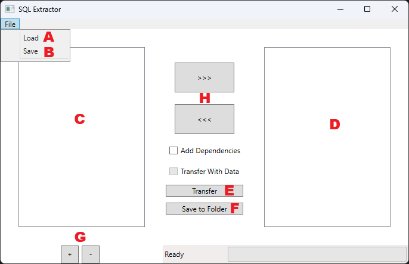
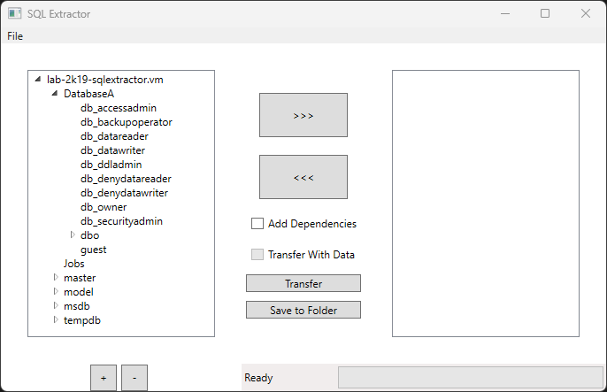
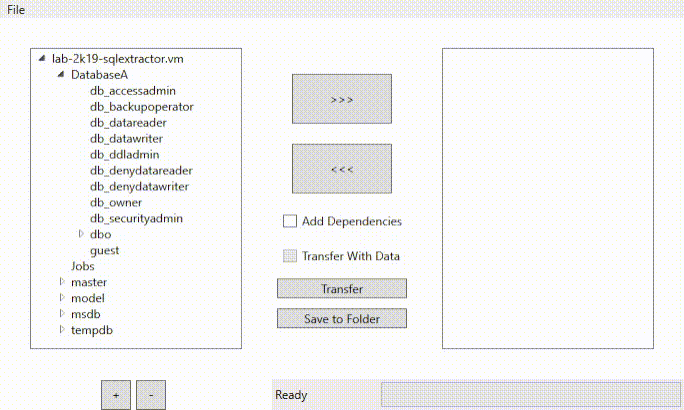
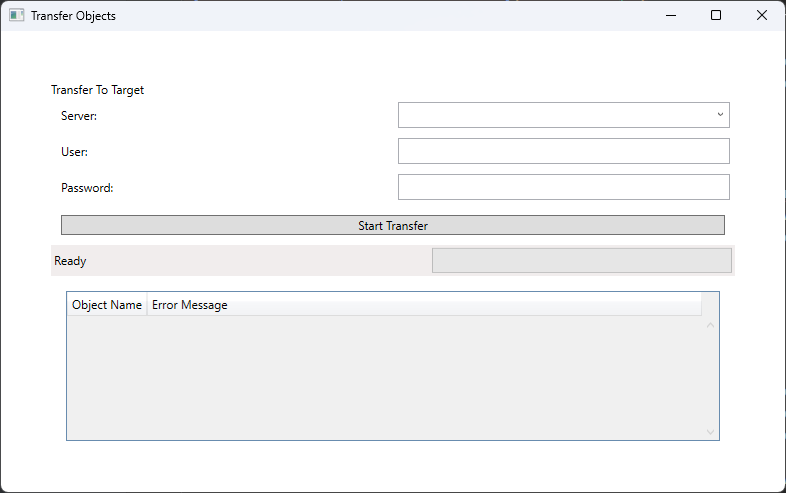

# SQL Extractor Tool
- *v1.3.1: Current Version*
- v1.3.0
- v1.2.2
- v1.2.1
- v1.2.0
- v1.1.0: Initial Release

---
## 1. Introduction
SQL Extractor is a tool for moving specific database objects between different server installs.
It can be used to extract database objects such as tables, views, or procedures from one data source to another.
You can also save the SQL definition code of the objects you selected.

---

## 2. Running SQL Extractor
SQL Extractor is a standalone executable that does not require installation. It runs on any x86_64 system running Windows 10 or later.

---

## 3. User Interface

- A: Load a [profile](#6-profiles) from a file into the output tree.
- B: Save the current contents of the output tree to a [profile](#6-profiles) file.
- C: Input Tree: A list of objects that can be added to the transfer.
- D: Output Tree: A list of objects that will be transferred.
- E: Transfer Button: When you click this button, you will be prompted to connect to a server. 
This server will be the receiver of the transfer.
- F: Open the window used to save the Output Tree to one or more .sql files.
- G: Use these buttons to add/remove servers from the Input Tree. You can select items from multiple servers.
- H: Use these buttons to move objects between the input and output tree.

---

## 4. Using the SQL Extractor
First, you need to provide some objects to copy. To do this, connect to a server using the *+* button at the bottom
left. The tool will index the database and show all available objects in the Input Tree.
-   Use the triangular icon to the left of the server name to expand the tree.

To select an object for transfer, **double-click** an item in the input tree. 
It will then be moved to the **output tree**.

If you want to include the data included in a table, click on a table object (in either the Input or Output tree)
and select "Transfer With Data".
If you want to automatically include the objects required for a certain object to work (dependencies), be sure to check
"Add Dependencies" before adding an object. Objects added as dependencies for another will show up in blue.

---

## 5. Transferring Data
To transfer the objects in the Output Tree to a target database, click "Transfer". You will be presented with a window 
where you can input the database where the objects will be transferred to. Additionally, any database errors that occur
while transferring the objects will show up in the list at the bottom of the screen.
Click "Start Transfer" to begin the transfer process.

---

## 6. Profiles
A profile is a file that can be used to quickly add certain objects to the output tree.
For example, if you find yourself transferring a set of certain stored procedures very often, saving those procedures
as a profile will prevent you from having to locate them in the input tree each time over and over again.

To create a profile, click on File > Save and provide a name for the file. All objects currently stored in the output 
tree will be stored in the new profile. To load a profile, click File > Load. The objects stored within the profile will
be quickly added to the output tree.

---

## 7. Save to Folder
You can also save your tree to one or more .sql files by using the Save To Folder button.
You'll be presented with three options:
- One file per object: The definition code for each object is contained within its own .sql file.
- One file per object type: Each object type has its own .sql file, similar to DB Ripper.
- One file: a single file is created for the entire tree.

---

## 8. Metadata
.sql files created by SQL Extractor contain metadata about the object or objects they contain.
This metadata is stored in a comment block above each top-level `CREATE` statement.
It is stored in an ini-like format.
The available metadata tags are as follows:

| Tag            | Description                                                          |
-----------------------------------------------------------------------------------------
| URN            | The object's URN.                                                    |
| OriginalServer | The IP address of the server where this object was originally found. |

## Questions? Comments? Concerns? Feedback?
[Email me!](mailto:christian.hollinger@elementlogic.us)